<p align="center">
  
</p>

<h3 align="center">📄 From a crooked phone photo of a book page ➜ 🧠 a searchable knowledge base ➜ 🎯 answers with the exact source highlighted</h3>

<p align="center">
  
  
  
  
  <br/>
  
  
  
  
  
  <br/>
  
  
  
</p>

<p align="center">
  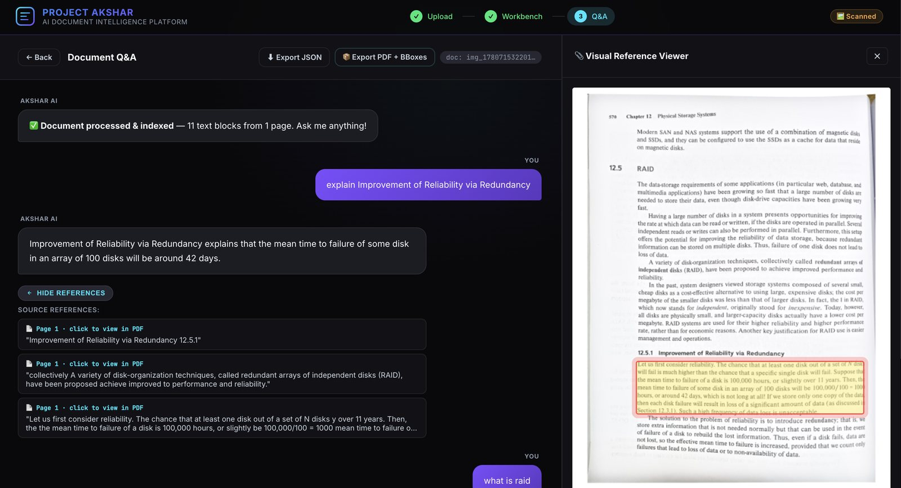
  <br/>
  <sub><i>Ask a question ➜ get an answer ➜ see the exact region of the page it came from, highlighted.</i></sub>
</p>

---

## 🧭 Table of Contents

| | | |
|---|---|---|
| [✨ About](#about) | [🧩 Modules](#modules) | [🛠 Tech Stack](#tech-stack) |
| [🌟 Features](#features) | [🚀 Quick Start](#quick-start) | [🔌 API Cheat Sheet](#api) |
| [🗺 Workflow](#workflow) | [📂 Project Layout](#layout) | [🔮 Roadmap](#roadmap) |
| [👥 Team](#team) | [🙏 Credits](#credits) | |

---

<a id="about"></a>
## ✨ About

**Project Akshar** is an end-to-end **document intelligence platform**. It takes raw, distorted camera captures of books, notes and paper documents and turns them into a **structured, spatially-aware knowledge base** you can question in natural language.

It bridges **classical computer vision** (corner detection, deskewing, dewarping, enhancement) with **modern generative AI** (layout-aware OCR, dense retrieval, RAG with an LLM) — and its signature trick is **visual grounding**: every answer comes with the exact paragraph on the original page **highlighted as evidence**. 🔍

> 💡 Inspired by industrial document-intelligence systems such as **Sarvam Akshar**, and built as a hands-on tour of computer vision, document analysis, information retrieval, vector databases and generative AI.

---

<a id="features"></a>
## 🌟 Features

| | Feature | What it does |
|:-:|---|---|
| 📸 | **Smart capture clean-up** | Orientation fix, corner detection, page split, deskew, perspective correction |
| 🌀 | **Three ways to dewarp** | Manual grid ✋, ML auto-dewarp 🤖, and training-free cubic B-spline polynomial dewarp 📐 |
| 🎨 | **Document enhancement** | Color 🌈 or black-and-white ⚫⚪ modes with shadow removal and illumination fix |
| 🔎 | **Layout-aware OCR** | PP-DocLayout detects titles, headers, paragraphs, lists & tables; PP-OCRv5 reads them |
| 📍 | **Visual grounding metadata** | Every text block keeps its page number and bounding box |
| 🧠 | **Grounded RAG** | BGE embeddings + ChromaDB retrieval + a local Llama 3 that answers *only* from evidence |
| 🖍 | **Evidence highlights** | Top-3 source regions are highlighted on the original page |
| 🔒 | **Fully local** | No cloud LLM needed — OCR, embeddings and the LLM all run on your machine |
| 🛟 | **Graceful fallbacks** | PyMuPDF text extraction kicks in if the OCR pipeline fails |
| 🧑‍💻 | **Human-in-the-loop UI** | A React workbench to drag corners, tune margins and re-run any step |

---

<a id="workflow"></a>
## 🗺 End-to-End Workflow

Documents are uploaded and **automatically classified**. 📑 **Scanned** files go through the **Image Workbench** (Modules 1 & 2) for clean-up, while **digital PDFs** skip straight to OCR & layout extraction (Module 3). The extracted blocks are embedded and stored in **ChromaDB**, powering **grounded RAG question answering** (Module 4).

<p align="center">
  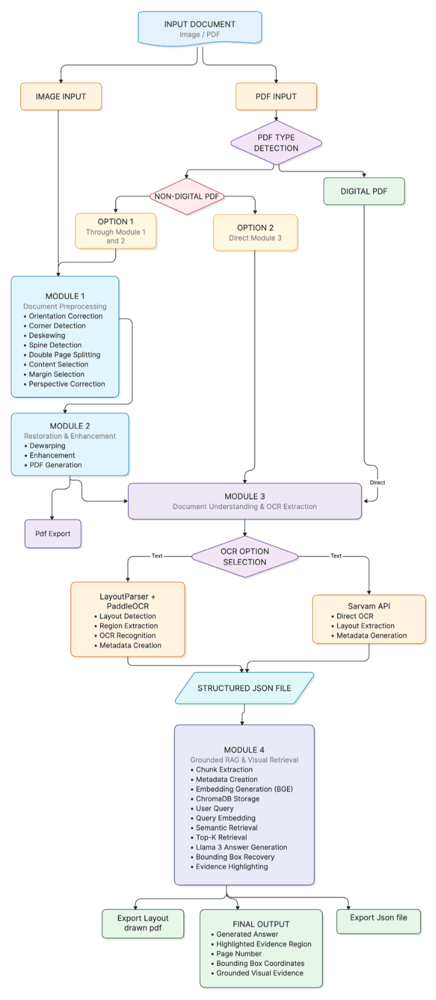
  <br/>
  <sub><i>Figure 1 · End-to-end workflow of Project Akshar</i></sub>
</p>

---

<a id="modules"></a>
## 🧩 Modules at a Glance

| # | Module | Role | Runs on |
|:-:|---|---|---|
| 1️⃣ | **Orchestrator & Interactive Workbench** 🎛 | Upload, PDF classification, corners, deskew, split, content & margins, perspective, pipeline orchestration | FastAPI `:8000` + React/Vite `:5173` |
| 2️⃣ | **Dewarping & Enhancement** 🌀 | Manual / ML / polynomial dewarping, enhancement, PDF export | FastAPI `:8001` (UI served from Module 1) |
| 3️⃣ | **Layout Detection & OCR** 🔎 | PP-DocLayout + PP-OCRv5, grounding metadata, PyMuPDF fallback | Library (called by Module 1) |
| 4️⃣ | **Grounded RAG** 🧠 | BGE embeddings, ChromaDB, Llama 3 via Ollama, evidence highlighting | Library (called by Module 1) · Ollama `:11434` |

---

## 1️⃣ Module 1 — Pipeline Orchestrator & Image Workbench 🎛

Module 1 is the front door of Akshar: it classifies uploads and walks every scanned page through a sequence of **geometric clean-up** steps — each one automatic, each one adjustable by hand.

<p align="center">
  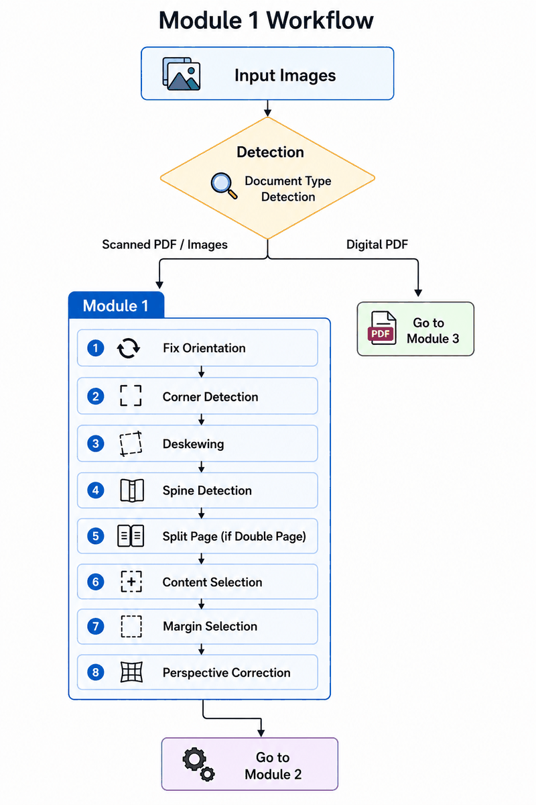
  <br/>
  <sub><i>Figure 2 · Module 1 workflow — Fix Orientation ➜ Corner Detection ➜ Deskew ➜ Spine Detection ➜ Split Page ➜ Content Selection ➜ Margins ➜ Perspective Correction</i></sub>
</p>

<p align="center">
  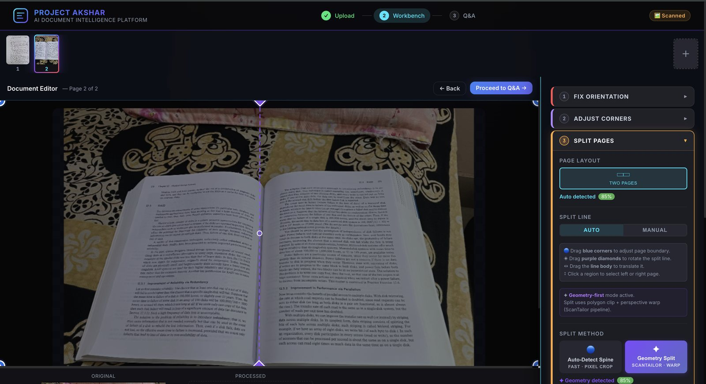
  <br/>
  <sub><i>Figure 3 · The Image Workbench — every step has a live, editable preview</i></sub>
</p>

### 📐 Corner Detection & Perspective Rectification

A multi-strategy cascade keeps detection robust under any lighting or background:

> **GrabCut** 🎯 ➜ *(fallback)* **HSV thresholding** 🌈 ➜ *(fallback)* **Canny edges** ✂️ ➜ contours ➜ convex hull ➜ **Douglas–Peucker** quad ➜ *(fallback)* `minAreaRect` ➜ corner ordering ➜ **homography** ➜ perspective warp

Prefer a learned detector? Akshar also ships a **CNN corner detector** (`OptimizedMobileNetwork`) — a MobileNetV3-inspired network with inverted residual bottlenecks and Squeeze-and-Excitation attention. It takes a **2048 × 2048 grayscale** image and regresses the **8 corner coordinates** (sigmoid head), trained with **5-fold cross-validation**.

<p align="center">
  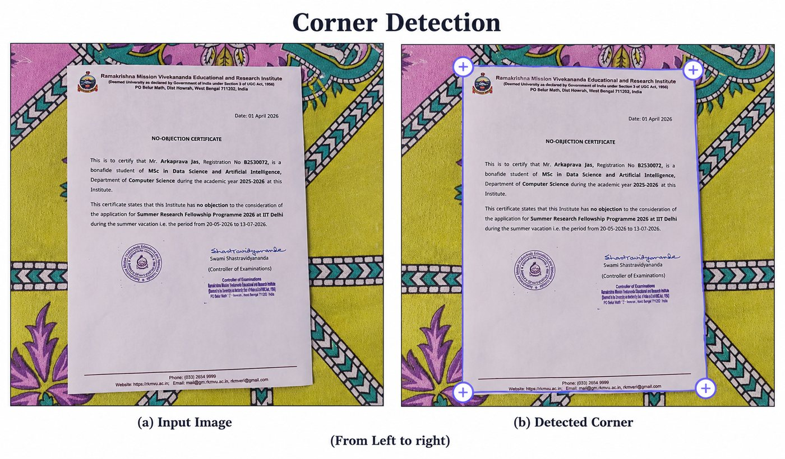
  <br/>
  <sub><i>Figure 4 · (a) input image · (b) detected corners</i></sub>
</p>

> 🖱 Corner not quite right? Drag it. The homography is recomputed and the rectified page regenerates **in real time**.

<p align="center">
  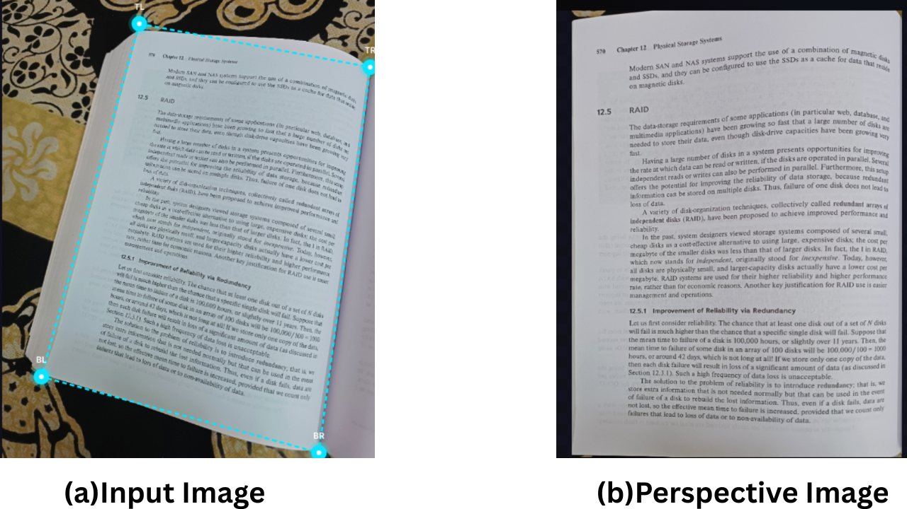
  <br/>
  <sub><i>Figure 5 · Perspective correction — (a) input · (b) rectified page</i></sub>
</p>

📦 **Training dataset:** [Google Drive link](https://drive.google.com/file/d/1RhfZsyZL-x3Z70kgXOarVWvaiVpxeXFi/view?usp=sharing)

### 📖 Page Split Detection

A two-pass, **ScanTailor-inspired** strategy tells single pages, double-page spreads and page-plus-offcut layouts apart:

1. 🔍 **VertLineFinder** — morphology + Probabilistic Hough Transform to find the spine / fold line.
2. 🧮 **Content-based fallback** — adaptive Otsu, morphological reconstruction, connected components and a *Content Span Finder* to locate whitespace gaps.

<p align="center">
  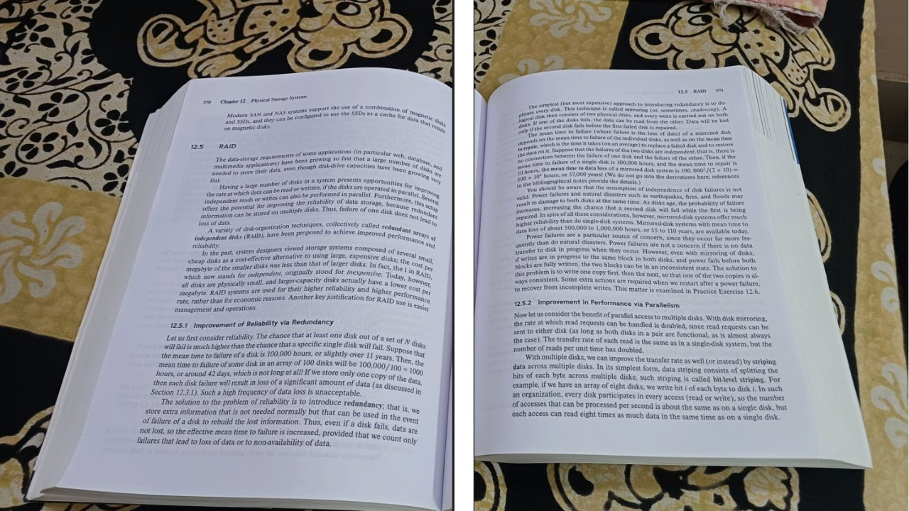
  <br/>
  <sub><i>Figure 6 · A double-page spread split into (a) left page and (b) right page</i></sub>
</p>

### 🧰 More Module 1 tools

| Tool | How it works |
|---|---|
| 📏 **Deskew** | Projection-profile variance ➜ Probabilistic Hough + weighted median ➜ `minAreaRect` fallback; canvas auto-expands so nothing is clipped |
| ✂️ **Content selection** | Detects and extracts the content region of each page |
| 🔲 **Margins** | Gaussian blur ➜ Otsu ➜ morphological closing ➜ largest contour; reports margins in **px and mm** (DPI-aware) and can apply custom white margins |

---

## 2️⃣ Module 2 — Dewarping, Enhancement & Export 🌀

<p align="center">
  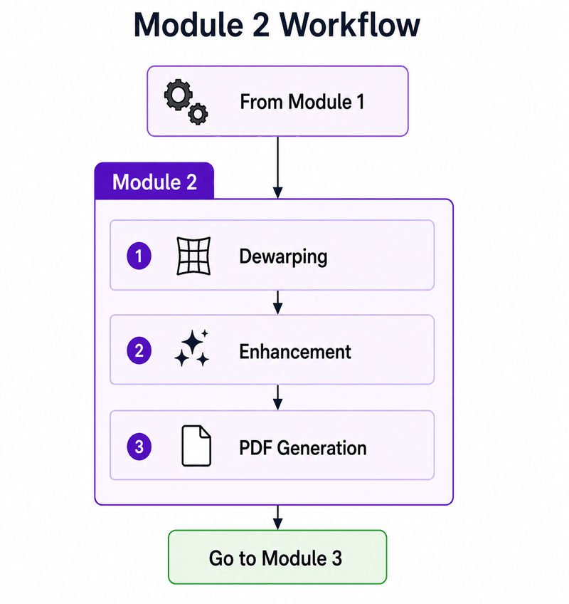
  <br/>
  <sub><i>Figure 7 · Module 2 — Dewarping ➜ Enhancement ➜ PDF Generation</i></sub>
</p>

Curled pages and book-binding bends make straight text lines look curved and hurt OCR. Akshar offers **three complementary dewarping strategies**, all built on **backward mapping**:

| Method | Best for | Needs weights? |
|---|---|:-:|
| ✋ **Manual grid** | Mild curvature & perspective; full user control | ❌ |
| 🤖 **ML auto-dewarp** | Severe warping, page curl, book-scan artifacts | ✅ `30.pt` |
| 📐 **Polynomial (cubic B-spline)** | Page-curl on text pages; interpretable & training-free | ❌ |

### ✋ Manual Grid Dewarping
A 4 × 4 grid of control points is dragged to match the page deformation. The sparse displacements are interpolated with **cubic scattered-data interpolation** (`scipy.interpolate.griddata`) and applied with **bicubic OpenCV remapping**.

<p align="center">
  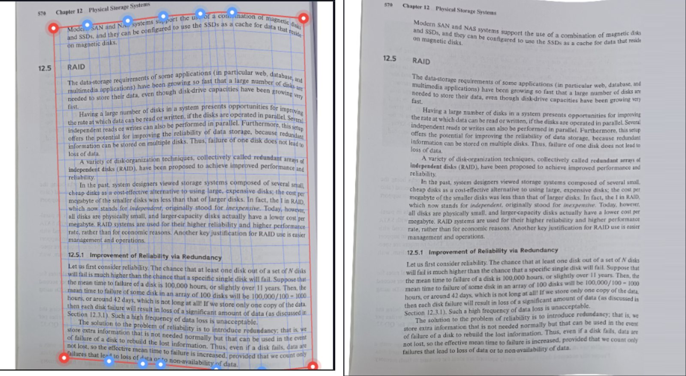
  <br/>
  <sub><i>Figure 8 · (a) input image with grid · (b) dewarped image</i></sub>
</p>

### 🤖 ML Auto-Dewarping
Based on **DewarpTextlineMaskGuide** from the ICCV 2023 paper *Foreground and Text-lines Aware Document Image Rectification*. Three parallel branches feed a **cross-attention transformer**:

- 🖼 **U2NETP** — foreground segmentation
- 📝 **UNet** — text-line detection (curved lines reveal the deformation)
- 🔧 **BasicEncoder** (RAFT-inspired) — appearance features
- ➕ Channel-attention module ➜ flow head & learned upsampling ➜ dense backward-mapping field

<p align="center">
  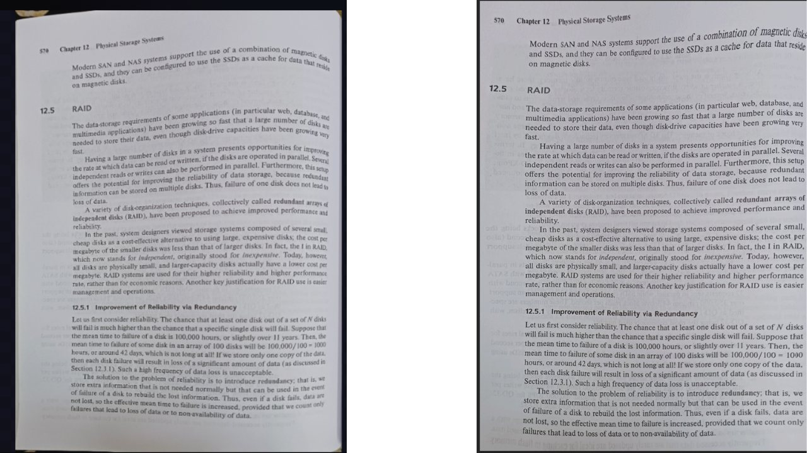
  <br/>
  <sub><i>Figure 9 · Left: input image · Right: auto-dewarped output</i></sub>
</p>

### 📐 Polynomial Dewarping with Cubic B-Splines
Entirely **geometry-based**: text density per vertical strip ➜ four reference curves tracked by **dynamic programming** ➜ smoothed ➜ **cubic B-spline** fit ➜ deformation field ➜ inverse remapping that "unrolls" the page.

<p align="center">
  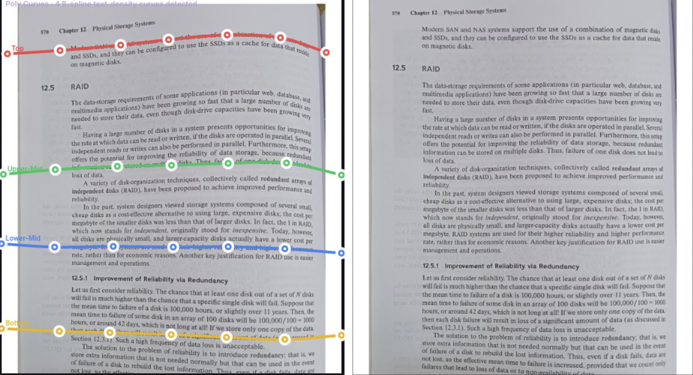
  <br/>
  <sub><i>Figure 10 · (a) input image with polynomial grid · (b) dewarped image</i></sub>
</p>

### 🎨 Document Enhancement
Pick **Color** 🌈 (keeps colored diagrams and annotations) or **B&W** ⚫⚪ (crisp binarized output):

<p align="center">
  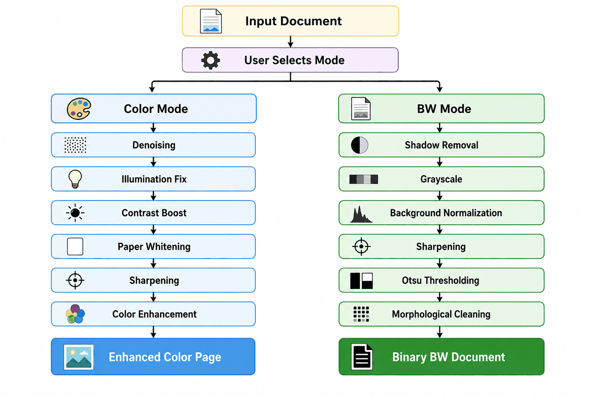
  <br/>
  <sub><i>Figure 11 · Enhancement pipeline</i></sub>
</p>

<p align="center">
  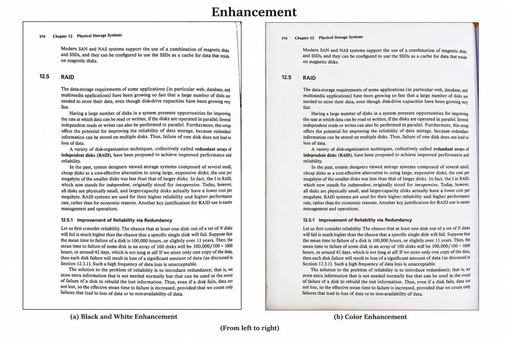
  <br/>
  <sub><i>Figure 12 · (a) Black & white enhancement · (b) Color enhancement</i></sub>
</p>

Extras: Otsu and **Adaptive Gaussian** binarization, **CLAHE** contrast enhancement, unsharp-mask sharpening and morphological noise removal.

### 📤 PDF Export
Processed pages are validated, colour-converted (BGR ➜ RGB), PNG-encoded **in memory**, and assembled **losslessly** into a multi-page PDF with `img2pdf` — no recompression, no temp files.

---

## 3️⃣ Module 3 — Layout Detection & OCR 🔎

Plain OCR throws away structure. Module 3 keeps **hierarchy, reading order, tables, lists and — most importantly — spatial position**.

<p align="center">
  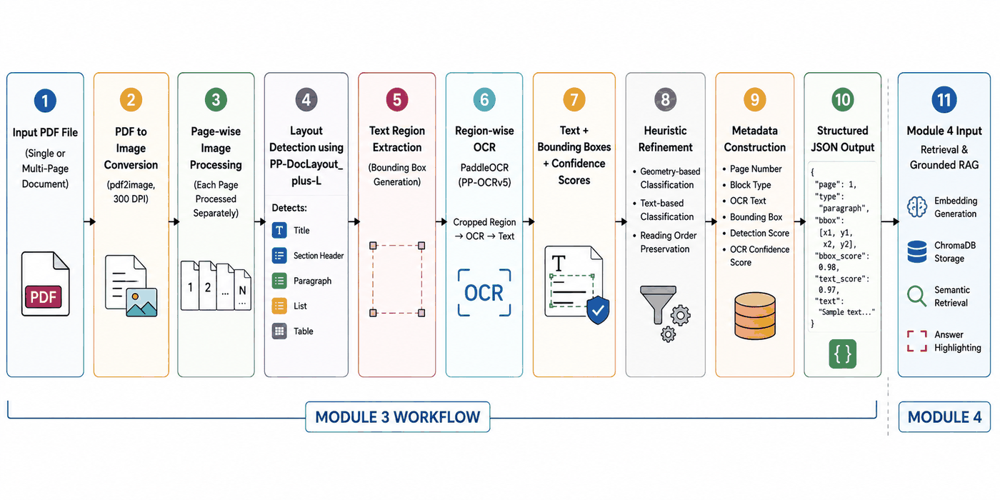
  <br/>
  <sub><i>Figure 13 · Module 3 workflow</i></sub>
</p>

**Pipeline:** `PDF` ➜ 📄 `pdf2image @ 300 DPI` ➜ 🧱 **PP-DocLayout_plus-L** (regions) ➜ ✂️ crop each region ➜ 🔤 **PP-OCRv5** (text) ➜ 🏷 metadata ➜ 📏 normalized bounding boxes

<p align="center">
  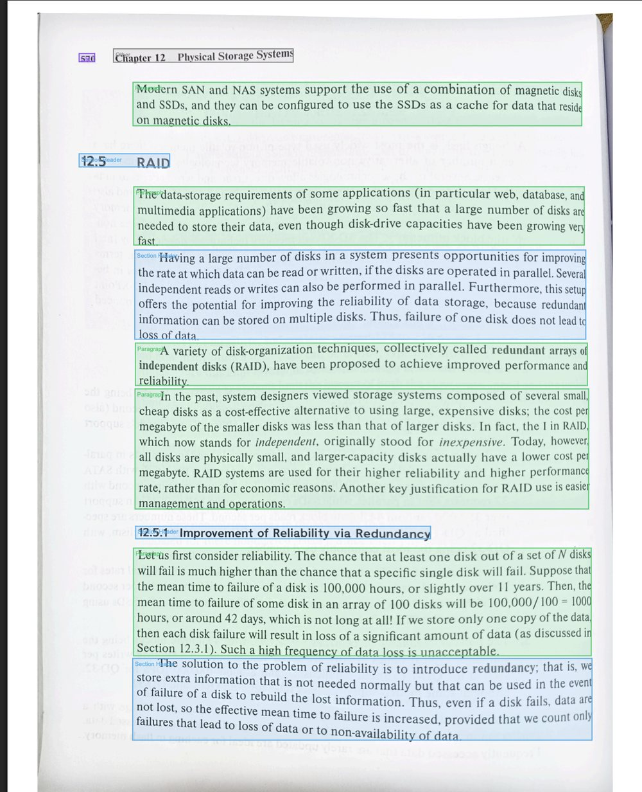
  <br/>
  <sub><i>Figure 14 · Layout detection — each region gets a label, confidence score and bounding box</i></sub>
</p>

Every block becomes a **grounding record**:

```json
{
  "page": 1,
  "type": "paragraph",
  "raw_label": "text",
  "score": 0.973,
  "bbox": [60, 140, 620, 320],
  "text": "Sample paragraph content..."
}
```

**📏 Resolution-independent boxes.** For an image of width *W* and height *H*:

$$B_{norm}=\left[\frac{x_{min}}{W},\ \frac{y_{min}}{H},\ \frac{x_{max}}{W},\ \frac{y_{max}}{H}\right]\in[0,1]$$

**🛟 Graceful degradation.** If a PDF is corrupted, a layout is unsupported, or an OCR model fails, Akshar falls back to **PyMuPDF** block extraction so text always stays accessible.

---

## 4️⃣ Module 4 — Grounded RAG & Vector Database 🧠

Module 4 is the reasoning layer. It embeds OCR chunks, stores them **with their page numbers and bounding boxes**, retrieves evidence for a question, and lets a local LLM answer from **that evidence only**.

<p align="center">
  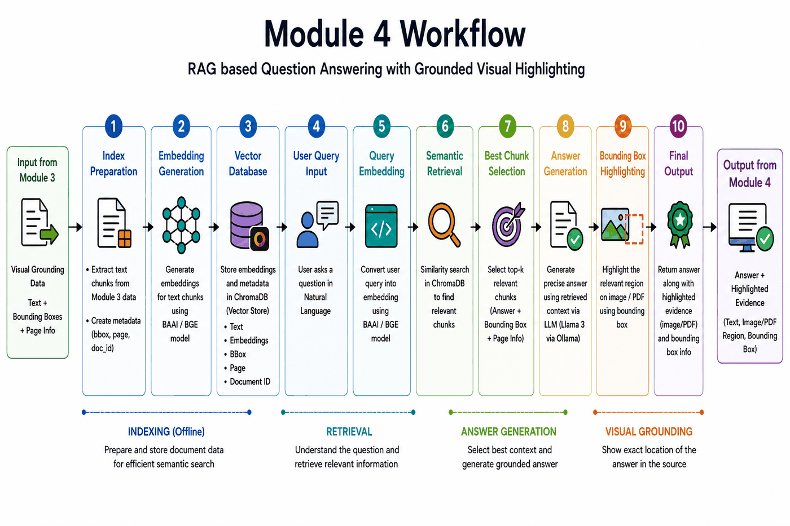
  <br/>
  <sub><i>Figure 15 · Module 4 workflow — indexing ➜ retrieval ➜ answer generation ➜ visual grounding</i></sub>
</p>

<p align="center">
  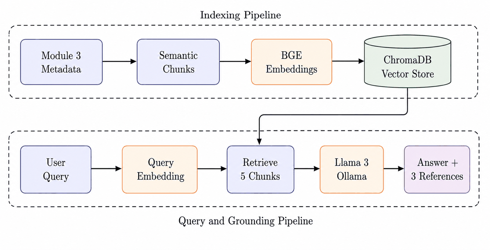
  <br/>
  <sub><i>Figure 16 · Indexing pipeline (top) and query & grounding pipeline (bottom)</i></sub>
</p>

| Step | What happens |
|:-:|---|
| 1️⃣ | OCR blocks from Module 3 become **semantic chunks** |
| 2️⃣ | Chunks are embedded with **`BAAI/bge-base-en-v1.5`** (768-dim) |
| 3️⃣ | Vectors + text + page number + bbox + document ID are stored in **ChromaDB** |
| 4️⃣ | The question is embedded in the same space; **5 chunks** are retrieved by cosine similarity |
| 5️⃣ | **Llama 3** (via Ollama) answers using **only** the retrieved context |
| 6️⃣ | The **top 3** chunks are highlighted on the original page as visual evidence |

$$\text{score}(q,e_i)=\frac{q\cdot e_i}{\lVert q\rVert\,\lVert e_i\rVert}$$

🛡 **Hallucination control.** The model is told to answer concisely, never speculate, and reply *"The document does not mention this."* when the evidence isn't there — so a cautious "I don't know" beats a fluent guess.

---

<a id="tech-stack"></a>
## 🛠 Tech Stack

| Layer | Tools |
|---|---|
| 🖼 **Classical CV** | OpenCV, NumPy, SciPy |
| 🤖 **Deep learning** | PyTorch (corner CNN, ML dewarp) |
| 🔎 **Layout & OCR** | PaddleOCR · PP-DocLayout_plus-L · PP-OCRv5 · PaddleX |
| 📄 **PDF handling** | pdf2image · PyMuPDF · img2pdf |
| 🧬 **Embeddings** | Sentence-Transformers · `BAAI/bge-base-en-v1.5` |
| 🗄 **Vector DB** | ChromaDB (persistent) |
| 🦙 **LLM** | Llama 3 via local Ollama |
| ⚙️ **Backend** | FastAPI · Uvicorn |
| 🖥 **Frontend** | React 19 · Vite · Axios · pdf.js |

---

<a id="quick-start"></a>
## 🚀 Quick Start

### 📋 Prerequisites

- 🐍 **Python 3.10** (3.9+ works)
- 🟢 **Node.js** + npm
- 📄 **poppler** (needed by `pdf2image`) — auto-installed on macOS via Homebrew; on Ubuntu/Debian run `sudo apt install poppler-utils`
- 🦙 **[Ollama](https://ollama.com)** for the local LLM

### 1️⃣ Clone & install

```bash
git clone https://github.com/ManasMondal2025/Project-Akshar.git
cd Project-Akshar

chmod +x setup.sh
./setup.sh
```

The setup script will:

- 📦 install `poppler` through Homebrew (if available)
- 🐍 create and activate the virtual environment `myenv1`
- 📥 install everything in `requirements.txt`
- 📂 create `uploads/`, `processed/`, `chroma_db/` and `pretrained_models/` folders
- 🟢 run `npm install` for the React frontend

### 2️⃣ Download the model weights ⬇️

Weights are too large for the repo, so grab them manually:

| Model | Used by | Download | Place at |
|---|---|---|---|
| 🌀 `30.pt` — ML auto-dewarp | Module 2 | [xiaomore/Document-Image-Dewarping](https://github.com/xiaomore/Document-Image-Dewarping) (Releases) or [Google Drive folder](https://drive.google.com/drive/folders/1UWL7wWSCcyhHuWLSKQRI9g2_cp0M0aD) | `module2/backend/pretrained_models/30.pt` |
| 📐 `best_model_fold_5.pth` — CNN corner detector | Module 1 | [Google Drive](https://drive.google.com/file/d/1YhSpmTSgb1XSblkkW6VFKfGGBVpJRCph/view?usp=sharing) | `module1/backend/pretrained_models/best_model_fold_5.pth` |

### 3️⃣ Get the local LLM 🦙

```bash
ollama pull llama3
ollama serve        # skip if the Ollama app is already running (default: http://localhost:11434)
```

### 4️⃣ Launch Akshar 🎉

Open **3 terminals** from the project root:

**🖥 Terminal 1 — Module 1 backend (port 8000)**
```bash
source myenv1/bin/activate
cd module1/backend
uvicorn main:app --port 8000 --reload
```

**🖥 Terminal 2 — Module 2 backend (port 8001)**
```bash
source myenv1/bin/activate
cd module2/backend
uvicorn main:app --port 8001 --reload
```

**🖥 Terminal 3 — Frontend (port 5173)**
```bash
cd module1/frontend
npm run dev
```

Then open **👉 http://localhost:5173** and drop in a document.

### 🧭 Typical session

1. 📤 **Upload** a PDF or photo.
2. 🛠 **Clean up** — fix orientation, adjust corners, deskew, split pages, set content area & margins, correct perspective.
3. 🌀 **Dewarp & enhance** — choose manual, ML or polynomial dewarping, then Color or B&W enhancement.
4. 📑 **Export** the processed pages to a PDF.
5. 🔎 **Run OCR & index** the document into ChromaDB.
6. 💬 **Ask questions** — read the answer and check the highlighted evidence on the page.

---

<a id="api"></a>
## 🔌 API Cheat Sheet

<details>
<summary><b>🅰️ Module 1 — <code>:8000</code></b> (click to expand)</summary>

| Endpoint | Purpose |
|---|---|
| `POST /pipeline/upload` | Upload a PDF or image |
| `POST /pipeline/detect` | Classify a PDF as digital or scanned |
| `POST /pipeline/extract-pages` | Extract scanned PDF pages as PNGs |
| `POST /pipeline/convert-to-pdf` | Assemble processed images into one PDF |
| `POST /pipeline/run-ocr` | Layout detection + OCR → grounding blocks |
| `POST /pipeline/index` | Index OCR blocks into ChromaDB |
| `POST /pipeline/query` | Ask a question → answer + highlighted references |
| `POST /corners/detect` · `/corners/apply` | Detect / apply document corners |
| `POST /transform` | Perspective transform |
| `POST /orient/*` · `/split/*` · `/content/*` · `/margins/*` | Orientation, page split, content & margin tools |

</details>

<details>
<summary><b>🅱️ Module 2 — <code>:8001</code></b> (click to expand)</summary>

| Endpoint | Purpose |
|---|---|
| `POST /deskew` · `/deskew/manual` | Automatic / manual deskew |
| `POST /dewarp` · `/dewarp/analyze-grid` | Manual grid dewarping |
| `POST /dewarp/auto` | ML auto-dewarp (`30.pt`) |
| `POST /dewarp/poly/estimate-curves` · `/dewarp/poly` | Polynomial B-spline dewarping |
| `POST /enhance/otsu` · `/enhance/adaptive` | Enhancement / binarization |
| `POST /export/pdf` · `/export/pdf-bbox` | PDF export |

</details>

> 📖 FastAPI also serves interactive docs at `/docs` on each backend (`http://localhost:8000/docs`, `http://localhost:8001/docs`).

---

<a id="layout"></a>
## 📂 Project Layout

```text
.
├── 📄 README.md
├── ⚙️  setup.sh                        # Automated installation script
├── 📦 requirements.txt                 # Unified Python dependencies (all modules)
├── 🗄  chroma_db/                      # ChromaDB vector store (auto-created)
│
├── 1️⃣  module1/                        # Orchestrator & Image Workbench
│   ├── backend/
│   │   ├── main.py                    # FastAPI app — port 8000
│   │   ├── pretrained_models/         # ← best_model_fold_5.pth (CNN corners)
│   │   ├── routes/                    # upload · corners · transform · scantailor · pipeline
│   │   └── utils/                     # cnn_corner_detect · edge_detect_corners · content_selection
│   │                                  # margins · page_split · page_layout · transform · pdf_utils
│   └── frontend/                      # React / Vite UI — port 5173
│
├── 2️⃣  module2/                        # Dewarping & Enhancement
│   └── backend/
│       ├── main.py                    # FastAPI app — port 8001
│       ├── pretrained_models/         # ← 30.pt (auto-dewarp)
│       ├── routes/                    # dewarp · enhance · export
│       └── utils/                     # scantailor · deskew · enhance · pdf_utils
│                                      # dewarp_ml/ (ML)  ·  poly_dewarp/ (B-spline)
│
├── 3️⃣  module3/                        # Local OCR pipeline
│   ├── pdf_layout_ocr.py              # PaddleOCR + PP-DocLayout
│   └── sarvam_client.py               # OCR orchestration + PyMuPDF fallback
│
├── 4️⃣  module4/                        # Grounded RAG
│   ├── vector_store.py                # ChromaDB indexing (BGE embeddings)
│   └── rag_inference.py               # Llama 3 via Ollama — RAG query
│
└── 🖼  assets/images/                  # Figures used in this README
```

---

<a id="roadmap"></a>
## 🔮 Roadmap

- 🌍 **Multilingual** document understanding
- ✍️ **Handwriting** recognition
- 🖼 **Multimodal** retrieval
- 📚 **Large-scale** document indexing
- 🤖 **Agentic** document reasoning

---

<a id="team"></a>
## 👥 Team

Built for the **Computer Vision** course, Department of Computer Science, **Ramakrishna Mission Vivekananda Educational and Research Institute (RKMVERI)**.

| 🧑‍🎓 | Name |
|:-:|---|
| 🌟 | **Arkaprava Jas** |
| 🌟 | **Manas Mondal** |
| 🌟 | **Anindya Midhey** |
| 🌟 | **Srijan Sarkar** |

---

<a id="credits"></a>
## 🙏 Credits & References

- 🇮🇳 [Sarvam Akshar](https://www.sarvam.ai/blogs/sarvam-akshar) — the industrial system that inspired this project
- ✂️ [ScanTailor Advanced](https://github.com/4lex4/scantailor-advanced) — page-split and margin pipeline inspiration
- 🌀 [Document-Image-Dewarping (xiaomore)](https://github.com/xiaomore/Document-Image-Dewarping) — ICCV 2023 *Foreground and Text-lines Aware Document Image Rectification*
- 👁 [OpenCV](https://docs.opencv.org/) — geometric transformations and image processing
- 🔎 [PaddleOCR](https://github.com/PaddlePaddle/PaddleOCR) · 🧬 [BGE](https://huggingface.co/BAAI/bge-base-en-v1.5) · 🗄 [ChromaDB](https://www.trychroma.com/) · 🦙 [Ollama](https://ollama.com)

---

<p align="center">
  <b>⭐ If Project Akshar helped you, consider giving it a star! ⭐</b><br/>
  <sub>Made with ❤️, 🐍 and a lot of ☕ at RKMVERI</sub>
</p>

<p align="center">
  
</p>
